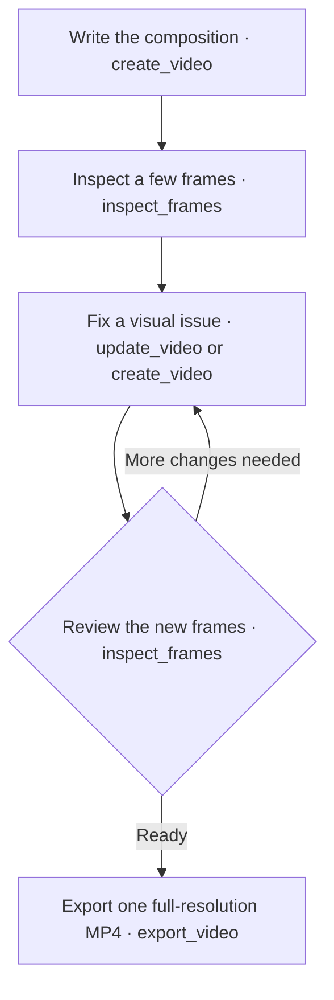

# Remotion MCP App — Visual Feedback Fork

**English** · [Русский](README.ru.md)

A fork of [mcp-use/remotion-mcp-app](https://github.com/mcp-use/remotion-mcp-app) that lets an AI agent inspect its own Remotion renders, improve the composition, and export a downloadable MP4. The original interactive player remains available for human review.

## Why this fork exists

The upstream app lets an agent write React/Remotion code and lets the user play the result in a compatible MCP client. The agent could revise the code, but it had no tool that returned actual rendered frames for visual review. This fork adds server-side rendering so an image-capable agent can spot issues such as clipped text, overlapping elements, or a jump between the last and first frames.

Draft reviews are fast because the renderer draws only a few selected frames at a reduced resolution. The agent can iterate on the same composition and spend the cost of a full video render once, at the end.

## The agent's workflow

**Write code → inspect a few frames → fix the composition → inspect again → export one MP4.**



The agent reviews about **5–7 representative frames** per iteration, including the first and last. These frames help it spot problems with readability, spacing, clipping, or the start and end of a loop. The live player lets you review motion between samples.

## Tools added by the fork

| Tool | What it does | When to use it |
| --- | --- | --- |
| `inspect_frames` | Renders selected frames from the current session's composition and returns a labeled contact sheet as PNG or JPEG image content in the MCP response. | After creating the composition and after each visual fix. |
| `export_video` | Renders the current composition to a full-resolution H.264 MP4 and returns a download link with file name and size. | Once the final inspection passes. |

Both tools work on the same project state as the live player. Call `update_video` to edit a mounted player in place. In a client without the player View, call `create_video` again with only the changed files. It merges those files into the project's current revision.

## Use it from your AI client

Select the Remotion MCP in your AI client and describe the video you want in chat. The agent writes the composition, calls the tools, and returns the MP4 link.

> Make a short square video that shows how an AI agent improves an Android UI. Use large text and no audio. Review a few representative frames after each revision and fix any readability or layout issues. Once the final frames look right, export one MP4.

You can ask for changes in the same conversation, for example, “Make the last title larger and check that it fits.” A compatible client can also show the live player for playback.

### Tool parameters for integrations

- `inspect_frames` accepts zero-based `frames` or a `count` for automatic sampling. The default is six frames. Previews fit within 480×480 without upscaling. To override the size, pass either `previewWidth` or `scale`. The default format is PNG. For JPEG, set `imageFormat: "jpeg"` and optionally `jpegQuality`.
- `export_video` accepts an optional `outputName` and `muted: true` to omit the audio track. It renders H.264 with `yuv420p` at full resolution, which requires even dimensions. Download the MP4 while the server is running. The file is temporary, and anyone with the link can download it while it is available.

## Run the fork locally

Use Node.js 22.22.2 or newer. The renderer needs a writable temporary directory and Chrome's system dependencies. On the first render Remotion can download Chrome Headless Shell. To use an existing compatible browser, set `REMOTION_BROWSER_EXECUTABLE`.

```bash
git clone https://github.com/hram/remotion-mcp-app.git
cd remotion-mcp-app
npm ci
npm run dev
```

Connect your MCP client to `http://localhost:3000/mcp` over Streamable HTTP. For scripted calls, keep a stable session identifier across creation, inspection, edits, and export. The server accepts `_meta["openai/session"]` or the `x-remotion-session-id` header. Session state lives in memory and is lost on restart.

The server executes supplied composition code during rendering. Run it in a trusted environment or isolate the renderer if you accept untrusted code. If you serve downloads through a reverse proxy, set `REMOTION_PUBLIC_URL` to the public server origin.

## Examples and tests

- [Hello World](examples/hello-world/render.ts) renders a minimal composition.
- [Android UI Renderer](examples/android-ui-renderer-x/pipeline.ts) shows the draft-and-export workflow for a short video.
- `npm test` checks frame selection, preview options, and session behavior. `npm run test:integration` builds the app and exercises two rounds of revisions followed by a full-resolution MP4 export through a real MCP client.

## Credits and license

Forked from [mcp-use/remotion-mcp-app](https://github.com/mcp-use/remotion-mcp-app). The app is built with [mcp-use](https://mcp-use.com) and [Remotion](https://remotion.dev). Its teaching tools are adapted from [Remotion's skills](https://github.com/remotion-dev/skills).

This repository is [MIT licensed](LICENSE). Remotion has its own [license terms](https://www.remotion.pro/license).
