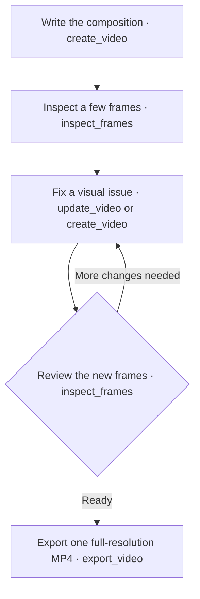

# Remotion MCP App — Visual Feedback Fork

**English** · [Русский](README.ru.md)

A fork of [mcp-use/remotion-mcp-app](https://github.com/mcp-use/remotion-mcp-app) that lets an AI agent inspect its own Remotion renders, improve the composition, and export a downloadable MP4. The original interactive player remains available for human review.

## Why this fork exists

The upstream app lets an agent write React/Remotion code and lets the user play the result in a compatible MCP client. The agent could revise the code, but it had no tool that returned actual rendered frames for visual review. This fork adds server-side rendering so an image-capable agent can spot issues such as clipped text, overlapping elements, or a jump between the last and first frames.

Draft reviews are fast because the renderer draws only a few selected frames at a reduced resolution. The agent can iterate on the same composition and spend the cost of a full video render once, at the end.

## The workflow

**Write code → inspect a few frames → fix the composition → inspect again → export one MP4.**



Keep each inspection to about **5–7 representative frames**, including the first and last. Check readability, spacing, clipping, and the visual transition between the end and the beginning of a loop. Use the live player to check motion between samples. After a fix, inspect again before exporting.

## Tools added by the fork

| Tool | What it does | When to use it |
| --- | --- | --- |
| `inspect_frames` | Renders selected frames from the current session's composition and returns a labeled contact sheet as PNG or JPEG image content in the MCP response. | After creating the composition and after each visual fix. |
| `export_video` | Renders the current composition to a full-resolution H.264 MP4 and returns a download link with file name and size. | Once the final inspection passes. |

Both tools work on the same project state as the live player. Call `update_video` to edit a mounted player in place. In a client without the player View, call `create_video` again with only the changed files. It merges those files into the project's current revision.

## Walkthrough

The following examples show MCP tool calls and their arguments. Make all calls in the same MCP session.

### 1. Write the composition

```js
const videoSource = `
  import { AbsoluteFill, useCurrentFrame, interpolate } from "remotion";
  import { Title } from "./Title";

  export default function Video() {
    const frame = useCurrentFrame();
    const offset = interpolate(frame, [0, 24], [40, 0], {
      extrapolateRight: "clamp",
    });

    return (
      <AbsoluteFill style={{
        backgroundColor: "#171d2b",
        color: "#fff",
        justifyContent: "center",
        alignItems: "center",
        padding: 72,
        textAlign: "center",
      }}>
        <div style={{ transform: "translateY(" + offset + "px)" }}>
          <Title />
        </div>
      </AbsoluteFill>
    );
  }
`;

create_video({
  files: JSON.stringify({
    "/src/Video.tsx": videoSource,
    "/src/Title.tsx": 'export function Title() { return <span style={{ fontSize: 100 }}>From code to video</span>; }',
  }),
  width: 1080,
  height: 1080,
  fps: 30,
  durationInFrames: 150,
});
```

### 2. Inspect, fix, and inspect again

```js
inspect_frames({
  frames: [0, 24, 60, 90, 120, 149],
  previewWidth: 480,
  imageFormat: "jpeg",
  jpegQuality: 75,
});
```

Open the returned contact sheet and decide what to change. For example, if the words feel cramped at preview size, give them more room by reducing the font size.

```js
// Call update_video instead when editing through a mounted player View.
create_video({
  files: JSON.stringify({
    "/src/Title.tsx": 'export function Title() { return <span style={{ fontSize: 80 }}>From code to video</span>; }',
  }),
});

inspect_frames({
  frames: [0, 24, 60, 90, 120, 149],
  previewWidth: 480,
  imageFormat: "jpeg",
  jpegQuality: 75,
});
```

Pass either explicit zero-based `frames` or a `count` for automatic sampling. The default is six frames spaced across the timeline. Previews fit within 480×480 by default without upscaling. Use `previewWidth` or `scale` to change the resolution. Remotion renders at that reduced size directly. The response also includes the original composition metadata and the effective preview dimensions. PNG is the default format.

### 3. Export once

```js
export_video({ outputName: "from-code-to-video.mp4", muted: true });
```

Export uses the composition's full resolution and current props. The output is H.264 with `yuv420p`, which requires even width and height. Set `muted: true` to omit the audio track. Download the MP4 from the returned URL while the server is running. Exports are temporary and anyone with the URL can download the file while it is available.

## Run the fork locally

Use Node.js 22.22.2 or newer. The renderer needs a writable temporary directory and Chrome's system dependencies. On the first render Remotion can download Chrome Headless Shell. To use an existing compatible browser, set `REMOTION_BROWSER_EXECUTABLE`.

```bash
git clone https://github.com/hram/remotion-mcp-app.git
cd remotion-mcp-app
npm ci
npm run dev
```

Connect your MCP client to `http://localhost:3000/mcp` over Streamable HTTP. For scripted calls, keep a stable session identifier across creation, inspection, edits, and export. The server accepts `_meta["openai/session"]` or the `x-remotion-session-id` header. Session state lives in memory and is lost on restart.

The server executes supplied composition code during rendering. Run it in a trusted environment or isolate the renderer if you accept untrusted code. If you serve downloads through a reverse proxy, set `REMOTION_PUBLIC_URL` to the public server origin.

## Examples and tests

- [Hello World](examples/hello-world/render.ts) renders a minimal composition.
- [Android UI Renderer](examples/android-ui-renderer-x/pipeline.ts) shows the draft-and-export workflow for a short video.
- `npm test` checks frame selection, preview options, and session behavior. `npm run test:integration` builds the app and exercises two rounds of revisions followed by a full-resolution MP4 export through a real MCP client.

## Credits and license

Forked from [mcp-use/remotion-mcp-app](https://github.com/mcp-use/remotion-mcp-app). The app is built with [mcp-use](https://mcp-use.com) and [Remotion](https://remotion.dev). Its teaching tools are adapted from [Remotion's skills](https://github.com/remotion-dev/skills).

This repository is [MIT licensed](LICENSE). Remotion has its own [license terms](https://www.remotion.pro/license).
