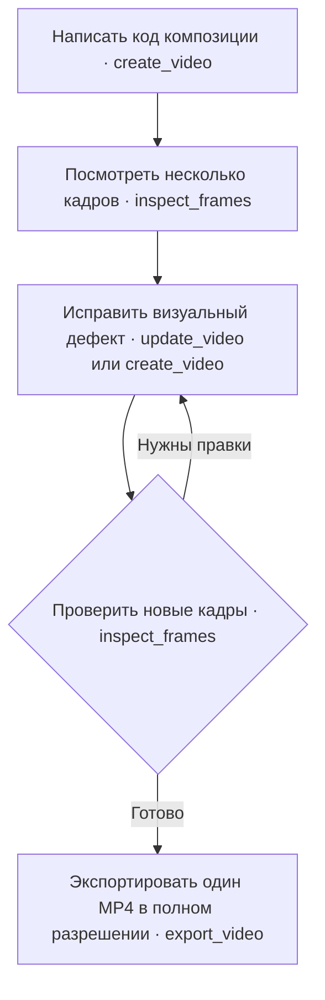

# Remotion MCP App — форк с визуальной проверкой

[English](README.md) · **Русский**

Это форк [mcp-use/remotion-mcp-app](https://github.com/mcp-use/remotion-mcp-app), в котором ИИ-агент может сам просматривать отрендеренные кадры, дорабатывать композицию и экспортировать готовый MP4. Интерактивный плеер из оригинального приложения по-прежнему доступен для просмотра пользователем.

## Зачем нужен этот форк

В оригинальном приложении агент пишет код на React и Remotion, а пользователь смотрит результат в совместимом MCP-клиенте. Агент мог править код, но у него не было инструмента, который возвращал бы отрендеренные кадры для визуальной проверки. В форке добавлен серверный рендеринг. Теперь агент, умеющий анализировать изображения, может заметить обрезанный текст, наложение элементов или скачок на стыке последнего и первого кадра.

В каждой итерации рендерятся только выбранные кадры в уменьшенном разрешении. Это позволяет быстро дорабатывать ту же композицию и запускать полный рендер видео один раз, в конце.

## Цикл работы

**Написать код → посмотреть несколько кадров → исправить → проверить снова → один раз экспортировать MP4.**



На каждой итерации достаточно выбрать **5–7 кадров**, включая первый и последний. Проверьте читаемость, отступы, обрезку элементов и стык конца с началом, если ролик зациклен. Движение между выбранными кадрами можно проверить в плеере. После каждой правки снова посмотрите кадры и только затем переходите к экспорту.

## Новые инструменты

| Инструмент | Что делает | Когда вызывать |
| --- | --- | --- |
| `inspect_frames` | Рендерит выбранные кадры текущей композиции и возвращает лист с подписанными кадрами как PNG- или JPEG-изображение прямо в ответе MCP. | После создания композиции и после каждой визуальной правки. |
| `export_video` | Рендерит текущую композицию в H.264 MP4 в полном разрешении и возвращает ссылку для скачивания, имя и размер файла. | Один раз после финальной проверки. |

Оба инструмента используют то же состояние композиции, что и плеер. Если плеер открыт, вызовите `update_video` для обновления на месте. В клиенте без встроенного плеера повторно вызовите `create_video`, передав только файлы, которые изменились. Инструмент объединит их с текущей версией проекта.

## Пример от кода до MP4

Ниже приведены вызовы MCP-инструментов и их аргументы. Выполняйте все вызовы в одной MCP-сессии.

### 1. Напишите код композиции

```js
const videoSource = `
  import { AbsoluteFill, useCurrentFrame, interpolate } from "remotion";
  import { Title } from "./Title";

  export default function Video() {
    const frame = useCurrentFrame();
    const offset = interpolate(frame, [0, 24], [40, 0], {
      extrapolateRight: "clamp",
    });

    return (
      <AbsoluteFill style={{
        backgroundColor: "#171d2b",
        color: "#fff",
        justifyContent: "center",
        alignItems: "center",
        padding: 72,
        textAlign: "center",
      }}>
        <div style={{ transform: "translateY(" + offset + "px)" }}>
          <Title />
        </div>
      </AbsoluteFill>
    );
  }
`;

create_video({
  files: JSON.stringify({
    "/src/Video.tsx": videoSource,
    "/src/Title.tsx": 'export function Title() { return <span style={{ fontSize: 100 }}>From code to video</span>; }',
  }),
  width: 1080,
  height: 1080,
  fps: 30,
  durationInFrames: 150,
});
```

### 2. Посмотрите кадры, внесите правку и проверьте снова

```js
inspect_frames({
  frames: [0, 24, 60, 90, 120, 149],
  previewWidth: 480,
  imageFormat: "jpeg",
  jpegQuality: 75,
});
```

Посмотрите на полученные кадры и решите, что поправить. Например, если заголовок выглядит тесно, уменьшите размер шрифта.

```js
// Если открыт встроенный плеер, вызовите update_video с теми же аргументами.
create_video({
  files: JSON.stringify({
    "/src/Title.tsx": 'export function Title() { return <span style={{ fontSize: 80 }}>From code to video</span>; }',
  }),
});

inspect_frames({
  frames: [0, 24, 60, 90, 120, 149],
  previewWidth: 480,
  imageFormat: "jpeg",
  jpegQuality: 75,
});
```

Передайте список номеров кадров `frames` с нумерацией от нуля или параметр `count`, чтобы инструмент выбрал кадры автоматически. По умолчанию берутся шесть кадров по всей длительности ролика. Превью вписываются в 480×480 без увеличения исходного размера. Чтобы задать другое разрешение, используйте `previewWidth` или `scale`. Remotion сразу рендерит кадры в этом разрешении. В ответе также есть исходные параметры композиции и фактические размеры превью. Формат по умолчанию — PNG.

### 3. Экспортируйте MP4 один раз

```js
export_video({ outputName: "from-code-to-video.mp4", muted: true });
```

Ролик экспортируется в полном разрешении с текущими параметрами композиции. Формат H.264 с `yuv420p` требует чётной ширины и высоты. Чтобы исключить звуковую дорожку, передайте `muted: true`. Скачайте MP4 по ссылке из ответа, пока сервер работает. Экспорты хранятся временно, и скачать файл может любой, у кого есть ссылка, пока она действует.

## Локальный запуск

Нужен Node.js 22.22.2 или новее. Для рендеринга требуется временный каталог с правом записи и системные зависимости Chrome. При первом рендере Remotion может скачать Chrome Headless Shell. Чтобы использовать уже установленный совместимый браузер, задайте `REMOTION_BROWSER_EXECUTABLE`.

```bash
git clone https://github.com/hram/remotion-mcp-app.git
cd remotion-mcp-app
npm ci
npm run dev
```

Подключите MCP-клиент к `http://localhost:3000/mcp` по Streamable HTTP. При вызовах из скрипта используйте один и тот же идентификатор сессии для создания, проверки, правок и экспорта. Сервер принимает `_meta["openai/session"]` или заголовок `x-remotion-session-id`. Состояние сессии хранится в памяти и сбрасывается при перезапуске.

При рендеринге сервер исполняет переданный код композиции. Запускайте его в доверенной среде или изолируйте рендерер, если принимаете код из недоверенных источников. Если файлы скачиваются через обратный прокси, задайте публичный адрес сервера в `REMOTION_PUBLIC_URL`.

## Примеры и тесты

- [Hello World](examples/hello-world/render.ts) рендерит минимальную композицию.
- [Android UI Renderer](examples/android-ui-renderer-x/pipeline.ts) показывает, как проверять черновые кадры и экспортировать короткий ролик.
- `npm test` проверяет выбор кадров, настройки превью и работу сессий. `npm run test:integration` собирает приложение, выполняет два раунда правок и экспортирует MP4 в полном разрешении через реальный MCP-клиент.

## Авторы и лицензия

Форк проекта [mcp-use/remotion-mcp-app](https://github.com/mcp-use/remotion-mcp-app). Приложение использует [mcp-use](https://mcp-use.com) и [Remotion](https://remotion.dev). Инструменты со справкой по Remotion адаптированы из [Remotion Skills](https://github.com/remotion-dev/skills).

Репозиторий распространяется по [лицензии MIT](LICENSE). У Remotion [собственные условия лицензирования](https://www.remotion.pro/license).
