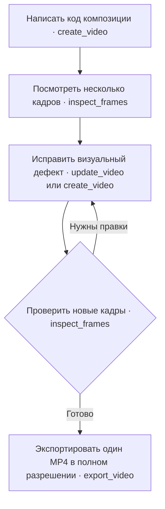

# Remotion MCP App — форк с визуальной проверкой

[English](README.md) · **Русский**

Это форк [mcp-use/remotion-mcp-app](https://github.com/mcp-use/remotion-mcp-app), в котором ИИ-агент может сам просматривать отрендеренные кадры, дорабатывать композицию и экспортировать готовый MP4. Интерактивный плеер из оригинального приложения по-прежнему доступен для просмотра пользователем.

## Зачем нужен этот форк

В оригинальном приложении агент пишет код на React и Remotion, а пользователь смотрит результат в совместимом MCP-клиенте. Агент мог править код, но у него не было инструмента, который возвращал бы отрендеренные кадры для визуальной проверки. В форке добавлен серверный рендеринг. Теперь агент, умеющий анализировать изображения, может заметить обрезанный текст, наложение элементов или скачок на стыке последнего и первого кадра.

В каждой итерации рендерятся только выбранные кадры в уменьшенном разрешении. Это позволяет быстро дорабатывать ту же композицию и запускать полный рендер видео один раз, в конце.

## Как работает агент

**Написать код → посмотреть несколько кадров → исправить → проверить снова → один раз экспортировать MP4.**



На каждой итерации агент проверяет примерно **5–7 кадров**, включая первый и последний. Так он может заметить проблемы с читаемостью, отступами, обрезкой элементов или стыком конца с началом в зацикленном ролике. Движение между этими кадрами можно посмотреть в плеере.

## Новые инструменты

| Инструмент | Что делает | Когда вызывать |
| --- | --- | --- |
| `inspect_frames` | Рендерит выбранные кадры текущей композиции и возвращает лист с подписанными кадрами как PNG- или JPEG-изображение прямо в ответе MCP. | После создания композиции и после каждой визуальной правки. |
| `export_video` | Рендерит текущую композицию в H.264 MP4 в полном разрешении и возвращает ссылку для скачивания, имя и размер файла. | Один раз после финальной проверки. |

Оба инструмента используют то же состояние композиции, что и плеер. Если плеер открыт, вызовите `update_video` для обновления на месте. В клиенте без встроенного плеера повторно вызовите `create_video`, передав только файлы, которые изменились. Инструмент объединит их с текущей версией проекта.

## Как пользоваться через чат

Подключите Remotion MCP в своём ИИ-клиенте и опишите ролик обычным сообщением. Агент сам напишет код композиции, вызовет инструменты и пришлёт ссылку на MP4.

> Сделай короткий квадратный ролик о том, как ИИ-агент дорабатывает интерфейс Android. Используй крупный текст, без звука. После каждой правки проверяй несколько кадров и исправляй проблемы с читаемостью или компоновкой. Когда финальные кадры будут готовы, один раз экспортируй MP4.

Правки можно попросить в том же чате, например «Сделай последний заголовок крупнее и проверь, что он помещается». Если клиент поддерживает встроенный плеер, в нём можно посмотреть ролик.

### Параметры инструментов для интеграций

- `inspect_frames` принимает список кадров `frames` с нумерацией от нуля или `count` для автоматического выбора. По умолчанию берутся шесть кадров, а превью вписываются в 480×480 без увеличения исходного размера. Для другого разрешения задайте `previewWidth` или `scale`. Формат по умолчанию — PNG. Для JPEG передайте `imageFormat: "jpeg"` и при необходимости `jpegQuality`.
- `export_video` принимает необязательное имя файла `outputName` и `muted: true`, чтобы исключить звуковую дорожку. Экспорт в H.264 с `yuv420p` идёт в полном разрешении и требует чётной ширины и высоты. Скачайте MP4, пока сервер работает. Файл хранится временно, и скачать его может любой, у кого есть действующая ссылка.

## Локальный запуск

Нужен Node.js 22.22.2 или новее. Для рендеринга требуется временный каталог с правом записи и системные зависимости Chrome. При первом рендере Remotion может скачать Chrome Headless Shell. Чтобы использовать уже установленный совместимый браузер, задайте `REMOTION_BROWSER_EXECUTABLE`.

```bash
git clone https://github.com/hram/remotion-mcp-app.git
cd remotion-mcp-app
npm ci
npm run dev
```

Подключите MCP-клиент к `http://localhost:3000/mcp` по Streamable HTTP. При вызовах из скрипта используйте один и тот же идентификатор сессии для создания, проверки, правок и экспорта. Сервер принимает `_meta["openai/session"]` или заголовок `x-remotion-session-id`. Состояние сессии хранится в памяти и сбрасывается при перезапуске.

При рендеринге сервер исполняет переданный код композиции. Запускайте его в доверенной среде или изолируйте рендерер, если принимаете код из недоверенных источников. Если файлы скачиваются через обратный прокси, задайте публичный адрес сервера в `REMOTION_PUBLIC_URL`.

## Примеры и тесты

- [Hello World](examples/hello-world/render.ts) рендерит минимальную композицию.
- [Android UI Renderer](examples/android-ui-renderer-x/pipeline.ts) показывает, как проверять черновые кадры и экспортировать короткий ролик.
- `npm test` проверяет выбор кадров, настройки превью и работу сессий. `npm run test:integration` собирает приложение, выполняет два раунда правок и экспортирует MP4 в полном разрешении через реальный MCP-клиент.

## Авторы и лицензия

Форк проекта [mcp-use/remotion-mcp-app](https://github.com/mcp-use/remotion-mcp-app). Приложение использует [mcp-use](https://mcp-use.com) и [Remotion](https://remotion.dev). Инструменты со справкой по Remotion адаптированы из [Remotion Skills](https://github.com/remotion-dev/skills).

Репозиторий распространяется по [лицензии MIT](LICENSE). У Remotion [собственные условия лицензирования](https://www.remotion.pro/license).
